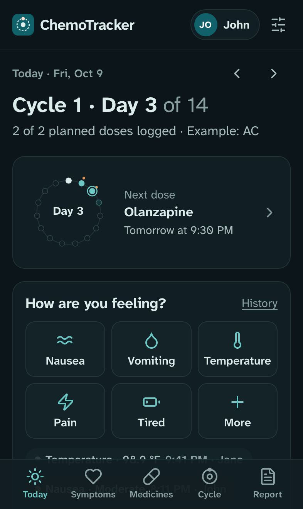

# ChemoTracker

A small self-hosted web app for keeping track of chemotherapy supportive medicines and symptoms. It works on phones and computers.

<p>
  
  
  
</p>


Screenshots use made-up demo data (`scripts/demo_seed.py`).

- **Today** groups doses into Morning, Afternoon, Evening and Bedtime by their scheduled time, plus clinic medicines on chemo day. Each dose has a large **Taken** button and a **Skip** button. Accidental taps can be undone.
- **As-needed medicines** show a countdown ring to when the next dose is allowed, based on the label (for example "every 6 hours"). The app also respects the days the clinic allows them.
- After a dose, the app asks **did it help?** and **how was the dose?** (about right, too strong, not enough). You can add side effects and notes.
- **Symptoms** are a core feature, not an add-on. Tap nausea, vomiting, temperature, pain, tiredness, diarrhea, constipation and more, then pick None, Mild, Moderate or Severe, or enter a number. After logging nausea, the app lists your own as-needed nausea medicines and when each one is allowed next. A temperature at or above the fever line, or anything marked severe, puts the care team's phone number front and center.
- A **cycle ring** shows where you are in the cycle. The **cycle sheet** is a day-by-day grid like the paper handouts clinics give out.
- **Report for the care team**: a styled Excel workbook (summary, day by day, dose log, symptoms, cycle sheet, medicine list) plus CSV files. Planned doses that were never logged show as "Not logged", so gaps are visible.
- **Medicine catalog**: about 50 medicines with plain-language summaries from MedlinePlus. It covers AC-T and other common chemo, targeted and hormone therapy, anti-nausea medicines, white-blood-cell boosters, pre-medicines, and bowel and comfort medicines. You can add custom medicines.
- **First-run walkthrough**: pick your medicines, copy each pharmacy label, set chemo day, add the care team's numbers. Everything stays editable later. There are no fixed protocol templates, because every person's schedule is different.
- **Automatic backups**: daily at 3:00 AM by default, to a folder you choose. Each backup is the database plus the Excel report.
- **People**: add the patient, family and caregivers. Each phone or computer remembers who is using it, and every dose and symptom records who logged it and who edited it ("John · edited by Jane"). The Excel and CSV reports include a "Logged by" column and a per-person count. Profiles are for attribution, not security. The family password is the lock.
- **Night mode** for bedtime doses, and fonts built for low-vision legibility (Atkinson Hyperlegible).

ChemoTracker keeps a record. It does not give medical advice, and the pharmacy label and your care team's instructions always come first.

## Run it with Docker

```bash
git clone https://github.com/outpoints/ChemoTracker.git
cd ChemoTracker
cp .env.example .env        # optional: set TZ, a family password, the backup folder
mkdir -p data backups
docker compose up -d --build
```

Open `http://<this-computer>:8000` on any phone or computer on the same network. On iPhone, use **Share → Add to Home Screen** to get an app icon.

Check it's healthy:

```bash
docker compose ps           # STATUS shows "healthy"
curl http://localhost:8000/healthz
```

On **Linux**, the container must be able to write to `./data` and the backup folder. Either set `CHEMO_UID`/`CHEMO_GID` in `.env` to your user (`id -u`, `id -g`), or run `sudo chown -R 10001:10001 data backups`.

### Keeping it private

All health data stays in `./data` (the SQLite database) and your backup folder. Both are git-ignored and never leave your machine unless you copy them.

- Set `CHEMO_PASSWORD` in `.env` if anyone besides your household can reach the port.
- To reach it away from home, use a private network such as [Tailscale](https://tailscale.com). Don't forward the port to the open internet.
- To bind it to the host computer only, set the port to `127.0.0.1:8000:8000` in `compose.yaml`.

## Configuration

Set these in `.env`. All of them are optional.

| Variable | Default | What it does |
|---|---|---|
| `TZ` | `America/Los_Angeles` | Time zone for dose times and backups |
| `CHEMO_PASSWORD` | unset | Family password for every page |
| `CHEMO_PUBLISH_PORT` | `8000` | Port on the host |
| `CHEMO_BACKUP_HOST_DIR` | `./backups` | Host folder for backups (an external drive or a synced folder works well) |
| `CHEMO_BACKUP_TIME` | `03:00` | Time of day the backup schedule is anchored to |
| `CHEMO_BACKUP_INTERVAL_HOURS` | `24` | How often to back up |
| `CHEMO_BACKUP_KEEP` | `30` | How many backups to keep (older ones are deleted) |
| `CHEMO_BACKUP_ENABLED` | `1` | Set to `0` to turn automatic backups off |
| `CHEMO_UID` / `CHEMO_GID` | `10001` | User the container runs as |
| `CHEMO_SECRET_KEY` | generated | Session signing key (stored in `data/.secret_key` if unset) |

## Backups and restore

Backups run inside the app. No cron is needed. If the computer was off at 3:00 AM, a catch-up backup runs a minute after the app starts. **Settings → Backups** shows the last good backup and the next one, and has **Back up now** and **Download a copy** buttons.

Each backup is two files:

- `chemotracker-YYYYMMDD-HHMMSS.sqlite3`: a consistent copy of the database, taken safely while the app runs
- `chemotracker-YYYYMMDD-HHMMSS.xlsx`: the full Excel report at that moment, readable without the app

To restore:

```bash
docker compose down
cp backups/chemotracker-YYYYMMDD-HHMMSS.sqlite3 data/chemotracker.sqlite3
rm -f data/chemotracker.sqlite3-wal data/chemotracker.sqlite3-shm
docker compose up -d
```

## Why a database, not a CSV

A CSV looks simple, but as the live store it breaks quickly. Two phones saving at the same time overwrite each other. Nothing stops a typo in a time. Opening the file in Excel can reformat dates and lock it.

So SQLite is the source of truth, and Excel and CSV files are generated from it whenever you need them. The care team gets clean, consistent files, and the data stays safe.

## People and devices

The first-run walkthrough asks who is using the app. After that:

- A phone or computer that hasn't been used before asks **Who's using this?** once and remembers the answer.
- Tap your name in the header (phone) or the sidebar (computer) to switch, for example when handing the phone to someone else.
- **Settings → People** adds, renames or removes people. Removed people keep their name on past entries.


## Demo data

To try the app or take screenshots without touching real data:

```bash
uv run python scripts/demo_seed.py /tmp/chemotracker-demo
CHEMO_DATA_DIR=/tmp/chemotracker-demo/data CHEMO_BACKUP_ENABLED=0 uv run chemotracker
uv run --with playwright python scripts/screenshots.py http://127.0.0.1:8000 docs/screenshots
```

The demo has three made-up people (John, Jane, Sam) and example doses. It refuses to overwrite an existing database unless you pass `--force`.

## Development

Requires [uv](https://docs.astral.sh/uv/).

```bash
uv sync
uv run pytest
CHEMO_DATA_DIR=./data uv run chemotracker     # http://127.0.0.1:8000
```

Layout:

- `src/chemotracker/web.py`: routes (server-rendered pages, plain HTML forms)
- `schedule.py`: cycle-day math, dose slots, time-of-day grouping, as-needed timing
- `store.py`: reads, writes and validation
- `export.py`: Excel and CSV reports
- `backup.py`: backup scheduler, snapshots, pruning
- `medinfo.py`: the medicine catalog
- `symptoms.py`: the symptom list and severity wording
- `profiles.py`: people and "logged by" attribution
- `templates/` and `static/`: UI (no JavaScript build step, and every page works without JavaScript)

Planned doses are not stored. They are computed from each cycle's Day 1 and the medicine's schedule (for example "Days 2–4 at 9:00 PM"), so moving chemo day moves every dose.

## Credits

- Medicine summaries are adapted from [MedlinePlus](https://medlineplus.gov/druginformation.html) (U.S. National Library of Medicine). Each medicine links to its source page.
- Fonts: [Atkinson Hyperlegible Next and Mono](https://www.brailleinstitute.org/freefont/) (SIL Open Font License, `src/chemotracker/static/fonts/OFL-LICENSE.txt`).
- Icons are adapted from [Lucide](https://lucide.dev) (ISC, `THIRD_PARTY_NOTICES/lucide-icons.txt`).

License: GPL-3.0.
