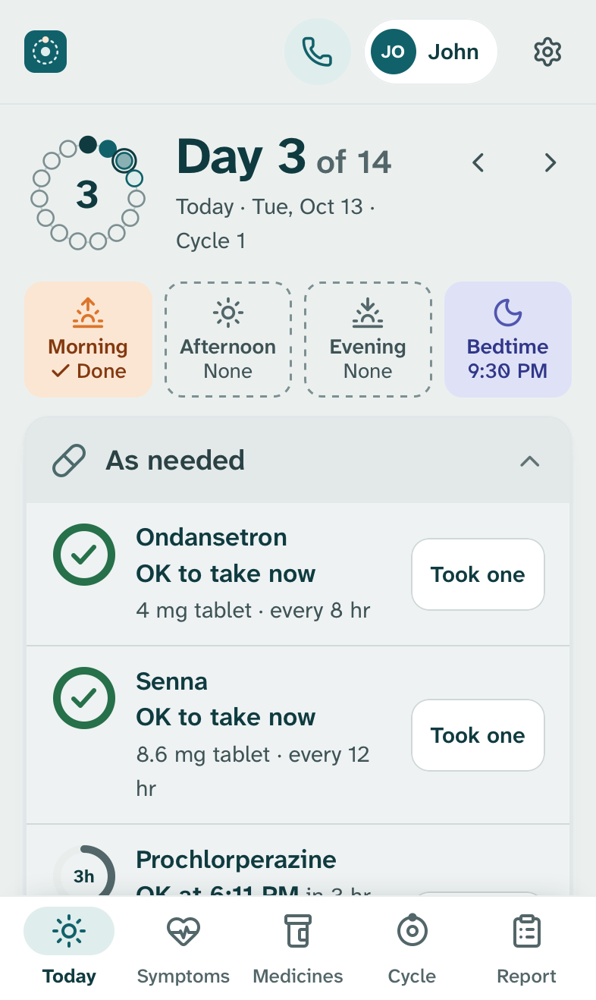
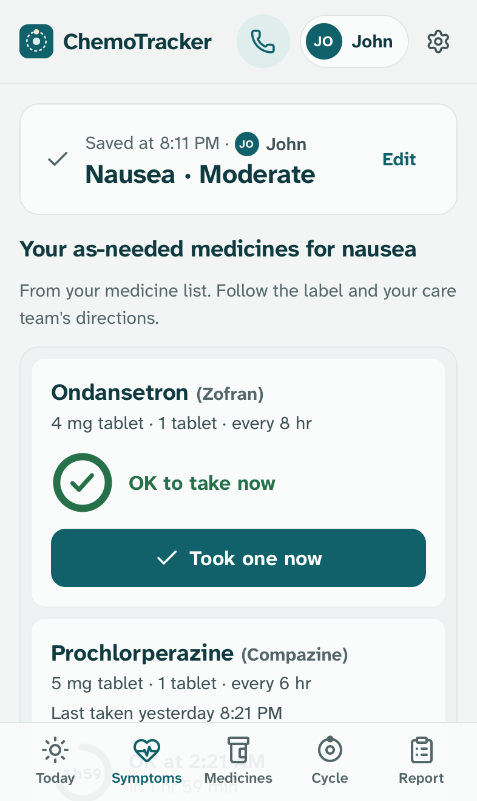
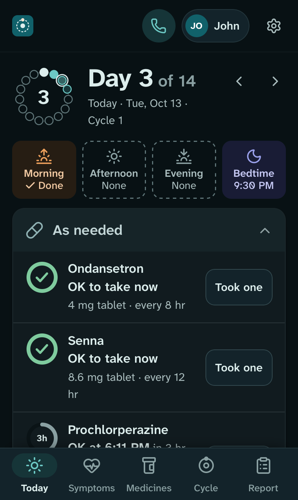
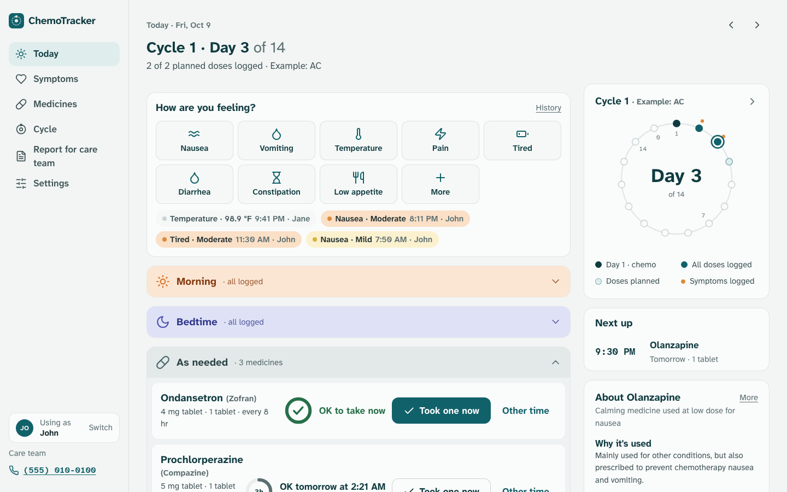
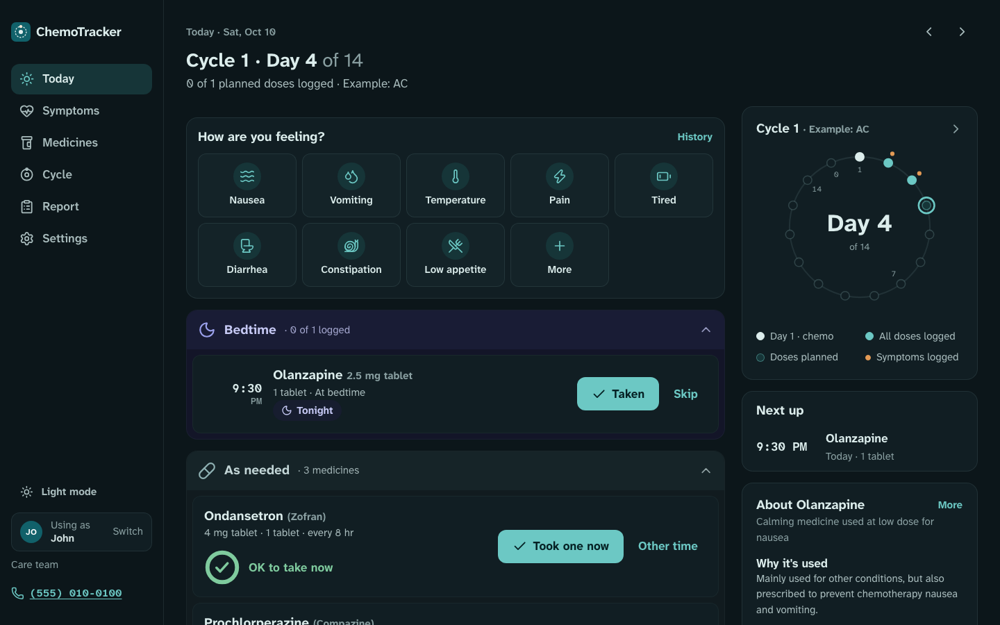
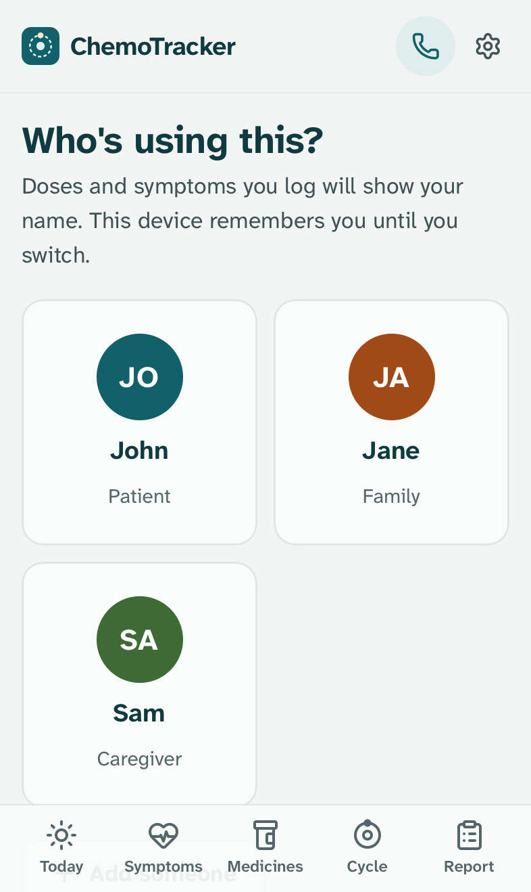

# ChemoTracker

A small self-hosted web app for keeping track of chemotherapy supportive medicines and symptoms. It works on phones and computers.

> [!WARNING]
> **This project is almost entirely vibe-coded.** I built it on the fly with AI coding tools, shaped by input from my mom and other family members as we used it. I've done my best to harden it, but it has never had a professional security review.
>
> **Run it on your home network or a private network like Tailscale, and never expose it to the open internet.** I don't expose any of my own services to the internet, and this shouldn't be the first. See [SECURITY.md](SECURITY.md) for how to run it safely, what's built in, and how the dependencies are pinned.

## Why this exists

I built ChemoTracker for my own family while someone we love goes through chemotherapy. The clinic gave us a paper sheet of anti-nausea medicines, pharmacy bottles with different schedules, and a list of symptoms to watch for. Keeping it all straight between several people, and showing the care team what actually happened, was harder than it should be.

This app is shaped around that use: a patient who is tired and nauseous, family members taking turns, and a care team that wants a clear record. Every family's situation is different, and I'd love for this to work just as smoothly for others going through cancer. **Pull requests are fully welcome**, from fixing a confusing word to adding a medicine or a whole feature. See [CONTRIBUTING.md](CONTRIBUTING.md) for how to help.

<p>
  
  
  
</p>



Screenshots use made-up demo data (`scripts/demo_seed.py`).

- **Today** groups doses into Morning, Afternoon, Evening and Bedtime by their scheduled time, plus clinic medicines on chemo day. Each dose has a large **Taken** button and a **Skip** button. Accidental taps can be undone.
- **As-needed medicines** show a countdown ring to when the next dose is allowed, based on the label (for example "every 6 hours"). The app also respects the days the clinic allows them.
- After a dose, the app asks **did it help?** and **how was the dose?** (about right, too strong, not enough). You can add side effects and notes.
- **Symptoms** are a core feature, not an add-on. Tap nausea, vomiting, temperature, pain, tiredness, diarrhea, constipation and more, then pick None, Mild, Moderate or Severe, or enter a number. After logging nausea, the app lists your own as-needed nausea medicines and when each one is allowed next. A temperature at or above the fever line, or anything marked severe, puts the care team's phone number front and center.
- A **cycle ring** shows where you are in the cycle. The **cycle sheet** is a day-by-day grid like the paper handouts clinics give out.
- **Report for the care team**: a styled Excel workbook (summary, day by day, dose log, symptoms, cycle sheet, medicine list) plus CSV files. Planned doses that were never logged show as "Not logged", so gaps are visible.
- **Medicine catalog**: about 50 medicines with plain-language summaries from MedlinePlus. It covers AC-T and other common chemo, targeted and hormone therapy, anti-nausea medicines, white-blood-cell boosters, pre-medicines, and bowel and comfort medicines. You can add custom medicines.
- **Write in your prescriptions**: type or paste what's on each bottle ("dexAMETHasone 4MG TAB - Take 2 tablets by mouth daily. Take on days 2, 3, AND 4 AFTER CHEMO THEN STOP") and the app fills in the strength, dose, how often, and the cycle days, with real dates counted from chemo day. It shows what it understood before saving and flags every guess. See [docs/prescription-formats.md](docs/prescription-formats.md) for what it reads and the sources behind it.
- **Chemo plans the way clinics write them**: chemo day, how often it repeats (every 1, 2, 3 or 4 weeks), how many cycles, and an optional second part ("AC every 14 days x 4, then paclitaxel weekly x 12"). Each cycle's date stays editable when treatment moves.
- **First-run walkthrough**: add who's using the app, set chemo day, add medicines, check each label, add the care team's numbers. Everything stays editable later. There are no fixed protocol templates, because every person's schedule is different.
- **Automatic backups**: daily at 3:00 AM by default, to a folder you choose. Each backup is the database plus the Excel report.
- **People**: add the patient, family and caregivers. Each phone or computer remembers who is using it, and every dose and symptom records who logged it and who edited it ("John · edited by Jane"). The Excel and CSV reports include a "Logged by" column and a per-person count. Profiles are for attribution, not security. For a lock, set the optional family password.
- **Light and dark themes** on phones and computers. Pick one in Settings, or let it follow the device. Dark is easier on the eyes at bedtime. Fonts are built for low-vision legibility (Atkinson Hyperlegible).
- **°C or °F**: pick the temperature unit in Settings. A reading typed in the other unit (like 38.2 when set to °F) is recognized and converted, and the fever line, report and CSV all follow the setting.
- **Safety checks for tired people**: logging an as-needed dose sooner than the label allows asks first. Moving a delayed chemo day offers to move every later cycle too. Re-running setup says exactly which medicines it stopped.
- **Several people, one record**: if two people log the same medicine within minutes, the second is asked first ("Jane logged one at 9:31 PM"). Tapping **Taken** on a dose someone else already recorded says so instead of overwriting it. Editing an entry someone else just changed shows their version first.
- **Get it ready ahead**: medicines that need a step before the dose show it on Today and get their own reminder, for example "Take it out of the fridge at 1:00 PM" for a 1:30 PM shot. Filgrastim and pegfilgrastim syringes start at 30 minutes, as their FDA labels say. Any medicine can have one.
- **Reminders on your phone** through the free [ntfy](https://ntfy.sh) app: when a dose is due, when one needs getting ready, when one still isn't marked after a while, and the evening before chemo. See [Reminders](#reminders).
- **Change history**: every dose, symptom, medicine, schedule and setting that's added, changed or deleted is recorded with who did it and the before and after. Deleted doses and symptom entries can be put back. The Excel report has a "Change history" sheet, so edits made after the fact are visible to the care team.
- **Restore from Settings**: pick a backup, see what's in it compared with now, and restore. The app saves the current record first, so a restore can be undone the same way.

ChemoTracker keeps a record. It does not give medical advice, and the pharmacy label and your care team's instructions always come first.

## Run it with Docker

```bash
git clone https://github.com/outpoints/ChemoTracker.git
cd ChemoTracker
cp .env.example .env        # optional: set TZ, a family password, the backup folder
mkdir -p data backups
docker compose up -d --build
```

Open `http://<this-computer>:8000` on any phone or computer on the same network. On iPhone, use **Share → Add to Home Screen** to get an app icon.

Check it's healthy:

```bash
docker compose ps           # STATUS shows "healthy"
curl http://localhost:8000/healthz
```

On **Linux**, the container must be able to write to `./data` and the backup folder. Either set `CHEMO_UID`/`CHEMO_GID` in `.env` to your user (`id -u`, `id -g`), or run `sudo chown -R 10001:10001 data backups`.

### Keeping it private

All health data stays in `./data` (the SQLite database) and your backup folder. Both are git-ignored and never leave your machine unless you copy them.

- **Use your home network (LAN) or Tailscale.** Never forward the port or put it on the open internet.
- A password is optional. Without one, anyone who can reach the port can use the app, which is fine on a trusted home network. Set `CHEMO_PASSWORD` in `.env` if people outside your household can reach it.
- A name on your home DNS (Pi-hole, your router) works with no setting. To answer only to your own names, list them in `CHEMO_ALLOWED_HOSTS`.
- To reach it away from home, use [Tailscale](https://tailscale.com): set `CHEMO_BIND=127.0.0.1`, run `tailscale serve --bg 8000`, and set `CHEMO_SECURE_COOKIE=1`. Only your own devices can reach it, over HTTPS.
- [SECURITY.md](SECURITY.md) covers reverse proxies, what's protected, and what isn't.

## Configuration

Set these in `.env`. All of them are optional.

| Variable | Default | What it does |
|---|---|---|
| `TZ` | `America/Los_Angeles` | Time zone for dose times and backups |
| `CHEMO_PASSWORD` | unset (no password) | Optional family password for every page. Leave it out to skip the sign-in screen |
| `CHEMO_PUBLISH_PORT` | `8000` | Port on the host |
| `CHEMO_BIND` | `0.0.0.0` | `0.0.0.0` reaches your home network. `127.0.0.1` keeps it on this computer (for Tailscale serve or a local proxy) |
| `CHEMO_ALLOWED_HOSTS` | unset (any name) | Only answer these names and addresses, comma-separated, e.g. `chemo.example.com,192.168.1.20`. Blocks DNS rebinding |
| `CHEMO_SECURE_COOKIE` | `0` | Set to `1` when the app is only reached over HTTPS |
| `CHEMO_FORWARDED_ALLOW_IPS` | `127.0.0.1` | Your reverse proxy's address, so the app sees each visitor's real address |
| `CHEMO_BACKUP_HOST_DIR` | `./backups` | Host folder for backups (an external drive or a synced folder works well) |
| `CHEMO_BACKUP_TIME` | `03:00` | Time of day the backup schedule is anchored to |
| `CHEMO_BACKUP_INTERVAL_HOURS` | `24` | How often to back up |
| `CHEMO_BACKUP_KEEP` | `30` | How many backups to keep (older ones are deleted) |
| `CHEMO_BACKUP_ENABLED` | `1` | Set to `0` to turn automatic backups off |
| `CHEMO_UID` / `CHEMO_GID` | `10001` | User the container runs as |
| `CHEMO_SECRET_KEY` | generated | Session signing key (stored in `data/.secret_key` if unset) |

## Backups and restore

Backups run inside the app. No cron is needed. If the computer was off at 3:00 AM, a catch-up backup runs a minute after the app starts. **Settings → Backups** shows the last good backup and the next one, and has **Back up now** and **Download a copy** buttons.

Each backup is two files:

- `chemotracker-YYYYMMDD-HHMMSS.sqlite3`: a consistent copy of the database, taken safely while the app runs
- `chemotracker-YYYYMMDD-HHMMSS.xlsx`: the full Excel report at that moment, readable without the app

**To restore**, open **Settings → Backups → Restore**, pick a backup, check what's in it, and tap **Restore this backup**. The app first saves what's there now as a "Saved before a restore" copy, so you can switch back. **Restore from a file** takes a copy made with **Download a copy**, for example from another computer.

Each copy is checked before it gets its final name, so a half-written or damaged copy never looks like a good backup. Before a new version changes the database's structure, the app also saves a `...-before-upgrade-vN.sqlite3` copy, and it won't upgrade if it can't.

**Don't open `data/chemotracker.sqlite3` with other programs while the app is running**, especially from outside Docker (Docker Desktop on a Mac or Windows runs the app in a separate virtual machine, and SQLite can't coordinate with it there). Use **Download a copy** instead. The app also refuses to start if another copy of it is already using the same `data` folder.

To restore by hand instead (for example if the app won't start):

```bash
docker compose down
cp backups/chemotracker-YYYYMMDD-HHMMSS.sqlite3 data/chemotracker.sqlite3
rm -f data/chemotracker.sqlite3-wal data/chemotracker.sqlite3-shm
docker compose up -d
```

## Reminders

Reminders use [ntfy](https://ntfy.sh), a free notification app with no account. Everyone who should get reminders subscribes to the same topic.

1. In **Settings → Reminders on your phone**, tick **Send reminders** and save. The app suggests a long random topic name.
2. On each phone, install **ntfy** (App Store or Google Play), tap **+**, and type that topic name.
3. Tap **Send a test**.

What gets sent:

- **Due**: at the dose time, or 5 to 60 minutes before. Doses at the same time come as one notification.
- **Get it ready**: at each medicine's prep time, for example "Take it out of the fridge: Filgrastim".
- **Not marked yet**: if a dose isn't marked taken or skipped after 15 to 90 minutes (or never).
- **Chemo tomorrow**: at 6:00 PM the day before each Day 1.

Tapping a notification opens ChemoTracker at the **Link address** in Settings. Use the address family members' phones reach, for example `http://192.168.1.20:8000` or your Tailscale name.

Privacy: on the public ntfy.sh server, anyone who knows a topic name can read its messages, so keep the long random name private. Turn off **Show medicine names** to send only "Medicine due at 9:30 PM". You can also run your own ntfy server and set it under **More options** (with an access token for a protected topic). On iPhones, a self-hosted server needs `upstream-base-url` set to deliver right away.

Reminders come from the server, so the computer running ChemoTracker has to be on and online. A reminder that couldn't go out within 45 minutes is dropped rather than sent late.

## Why a database, not a CSV

A CSV looks simple, but as the live store it breaks quickly. Two phones saving at the same time overwrite each other. Nothing stops a typo in a time. Opening the file in Excel can reformat dates and lock it.

So SQLite is the source of truth, and Excel and CSV files are generated from it whenever you need them. The care team gets clean, consistent files, and the data stays safe.

## People and devices

The first-run walkthrough asks who is using the app. After that:

- A phone or computer that hasn't been used before asks **Who's using this?** once and remembers the answer.
- Tap your name in the header (phone) or the sidebar (computer) to switch, for example when handing the phone to someone else.
- **Settings → People** adds, renames or removes people. Removed people keep their name on past entries.



## Demo data

To try the app or take screenshots without touching real data:

```bash
uv run python scripts/demo_seed.py /tmp/chemotracker-demo
CHEMO_DATA_DIR=/tmp/chemotracker-demo/data CHEMO_BACKUP_ENABLED=0 uv run chemotracker
uv run --with playwright python scripts/screenshots.py http://127.0.0.1:8000 docs/screenshots
```

The demo has three made-up people (John, Jane, Sam) and example doses. It refuses to overwrite an existing database unless you pass `--force`.

## Development

Requires [uv](https://docs.astral.sh/uv/). Read [CONTRIBUTING.md](CONTRIBUTING.md) first: **no personal information ever goes into this repo**, and every screen is designed for the least technical person in the family.

```bash
git config core.hooksPath .githooks          # blocks commits containing personal information
uv sync
uv run pytest
CHEMO_DATA_DIR=./data uv run chemotracker     # http://127.0.0.1:8000
```

Layout:

- `src/chemotracker/web.py`: routes (server-rendered pages, plain HTML forms)
- `schedule.py`: cycle-day math, dose slots, time-of-day grouping, as-needed timing
- `store.py`: reads, writes and validation
- `export.py`: Excel and CSV reports
- `backup.py`: backup scheduler, snapshots, pruning
- `medinfo.py`: the medicine catalog
- `symptoms.py`: the symptom list and severity wording
- `profiles.py`: people and "logged by" attribution
- `rxparse.py`: reads typed or pasted prescriptions (see `docs/prescription-formats.md`)
- `units.py`: °C / °F handling
- `history.py`: change history (written by SQLite triggers, see `db.py`)
- `reminders.py`: ntfy reminders
- `security.py`: cross-site and host checks, security headers, sign-in throttle
- `templates/` and `static/`: UI (no JavaScript build step, and every page works without JavaScript)

Planned doses are not stored. They are computed from each cycle's Day 1 and the medicine's schedule (for example "Days 2–4 at 9:00 PM"), so moving chemo day moves every dose.

## Dependencies

Running it needs only Docker. The app uses seven Python packages (FastAPI, Uvicorn, Jinja2, python-multipart, openpyxl, itsdangerous, tzdata), each pinned to an exact version and locked with a checksum in `uv.lock`, along with everything they bring in. Fonts and icons are bundled, so nothing loads from other sites. Dependabot proposes updates weekly, and CI checks the locked packages for known vulnerabilities. Details are in [SECURITY.md](SECURITY.md#dependencies).

## To do

Built for one family during a loved one's chemo, so some things aren't done yet. Pull requests are welcome.

- [ ] **More than one patient per install.** Today each install tracks one person. A household with two people in treatment needs two installs (two `data` folders and ports).
- [ ] **Offline logging.** Phones need to reach the server to log. A safe version would show the last loaded Today page offline, queue taps with a unique ID so they're never saved twice, and on reconnecting show anything that clashed with what someone else logged meanwhile.
- [ ] **Test on a Raspberry Pi.** The app is built to be light (no build step, SQLite, about 4 ms per prescription parse), but it hasn't been run on a Pi yet.

## Credits

- Medicine summaries are adapted from [MedlinePlus](https://medlineplus.gov/druginformation.html) (U.S. National Library of Medicine). Each medicine links to its source page.
- Fonts: [Atkinson Hyperlegible Next and Mono](https://www.brailleinstitute.org/freefont/) (SIL Open Font License, `src/chemotracker/static/fonts/OFL-LICENSE.txt`).
- Icons are adapted from [Lucide](https://lucide.dev) (ISC, `THIRD_PARTY_NOTICES/lucide-icons.txt`).

License: GPL-3.0.
