# Setting up ChemoTracker

This guide is for whoever sets ChemoTracker up for the family. It takes about 15 minutes, plus the time to copy in your medicines. Have the pharmacy labels and the clinic's medicine schedule nearby.

The screenshots use made-up people (John, Jane and Sam) and example doses.

1. [What you need](#what-you-need)
2. [Install Docker](#install-docker)
3. [Download and start ChemoTracker](#download-and-start-chemotracker)
4. [Open it on each phone](#open-it-on-each-phone)
5. [The first-run walkthrough](#the-first-run-walkthrough)
6. [Reminders on your phone](#reminders-on-your-phone)
7. [Backups](#backups)
8. [On a NAS](#on-a-nas)
9. [Away from home](#away-from-home)
10. [Updating](#updating)
11. [Show the family](#show-the-family)
12. [If something isn't working](#if-something-isnt-working)

## What you need

- **A computer that stays on at home.** A Mac, a Windows PC, a Linux machine or a NAS that runs Docker. Reminders and backups come from this computer, so it has to be on and awake. A Raspberry Pi should work, but it hasn't been tested yet.
- **Phones on the same Wi-Fi** as that computer. To use it away from home, see [Away from home](#away-from-home).

ChemoTracker keeps everything on that computer. Nothing is sent to an outside service, except reminders if you turn them on.

## Install Docker

- **Mac or Windows:** install [Docker Desktop](https://docs.docker.com/desktop/) and open it once. In its settings, turn on starting Docker Desktop when you sign in, so ChemoTracker comes back after a restart.
- **Linux:** install [Docker Engine](https://docs.docker.com/engine/install/) with the Compose plugin.
- **NAS:** use its Docker app (Container Manager on Synology, for example) and see [On a NAS](#on-a-nas).

## Download and start ChemoTracker

Open a terminal and run:

```bash
git clone https://github.com/outpoints/ChemoTracker.git
cd ChemoTracker
cp .env.example .env
```

Open `.env` in a text editor. Every line is optional, and the file explains each one. The ones most people change:

- `TZ`: your time zone, for example `America/New_York` or `Europe/London`. Dose times and the daily backup use it.
- `CHEMO_PASSWORD`: a family password. Leave it out on a trusted home network. Set it if people outside your household can reach the computer.
- `CHEMO_BACKUP_HOST_DIR`: where backups go. An external drive or a synced folder is safer than the same disk as the app.
- `CHEMO_DATA_HOST_DIR`: where the database goes, if not `./data` next to `compose.yaml`.

Then start it:

```bash
mkdir -p data backups
docker compose up -d --build
docker compose ps
```

After a minute, `docker compose ps` shows `healthy`. It restarts on its own after a reboot, as long as Docker starts.

On **Linux**, the container runs as user 10001. Either set `CHEMO_UID` and `CHEMO_GID` in `.env` to your own (`id -u`, `id -g`) or run `sudo chown -R 10001:10001 data backups`.

## Open it on each phone

Find the computer's address on your network:

- **Mac:** System Settings → Wi-Fi → Details next to your network, or run `ipconfig getifaddr en0` in a terminal.
- **Windows:** run `ipconfig` and look for "IPv4 Address".
- **Linux:** run `hostname -I`.

On each phone, open `http://<that address>:8000` in the browser, for example `http://192.168.1.20:8000`. Then add it to the home screen so it opens like an app:

- **iPhone (Safari):** Share → Add to Home Screen.
- **Android (Chrome):** the ⋮ menu → Add to Home screen.

The address can change when the router restarts. To keep it, give the computer a fixed address in your router's settings (often called a DHCP reservation). A name on your home DNS, like a Pi-hole entry, also works.

## The first-run walkthrough

The first time anyone opens ChemoTracker, it walks through six short steps. Everything can be changed later.

<p>
  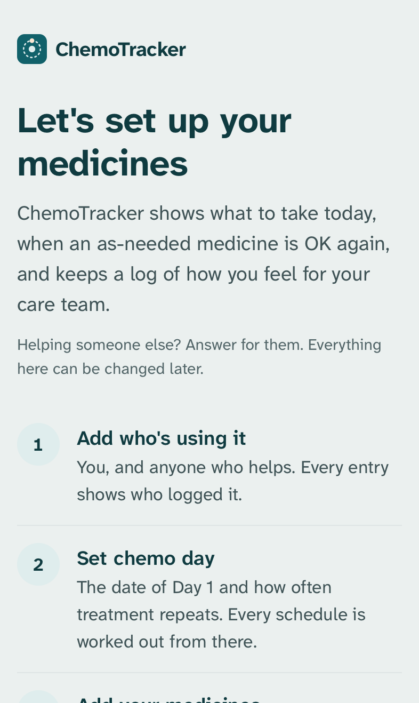
  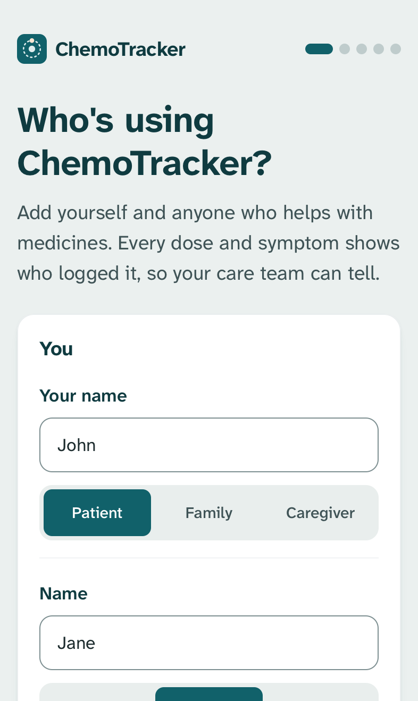
  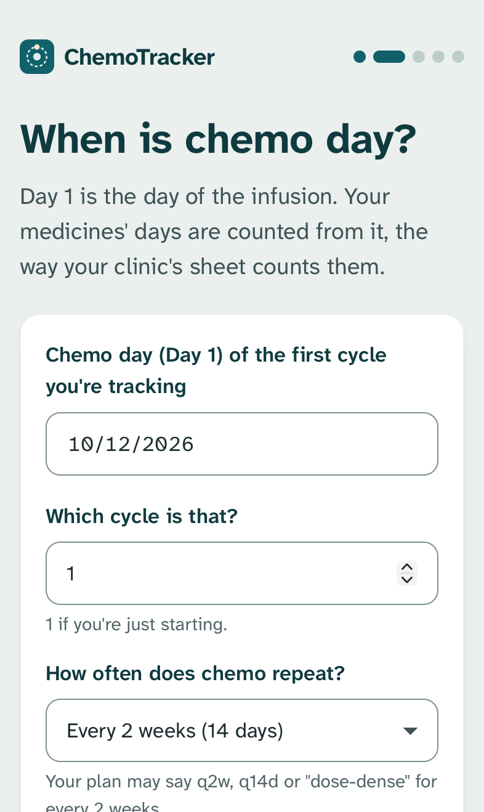
</p>

1. **Welcome.** What the app does and what the next steps are.
2. **Who's using ChemoTracker?** Add yourself and anyone who helps with medicines: the patient, family, a caregiver. Every dose and symptom records who logged it, so the care team can tell. These are names, not accounts, so there are no passwords to remember.
3. **When is chemo day?** Day 1 is the day of the infusion. Your medicines' days count from it, the way the clinic's sheet counts them. Add how often chemo repeats and how many cycles. If the plan has a second part, like "AC every 2 weeks × 4, then paclitaxel weekly × 12", open "Then a second part". A delayed chemo day can be moved later, and its doses move with it.

<p>
  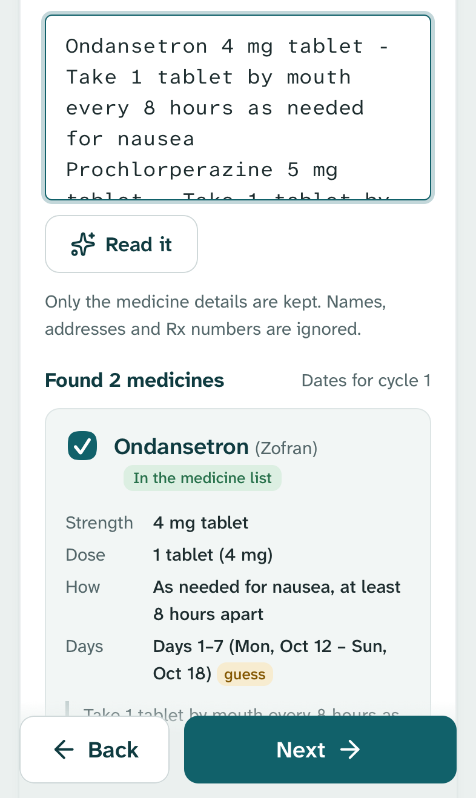
  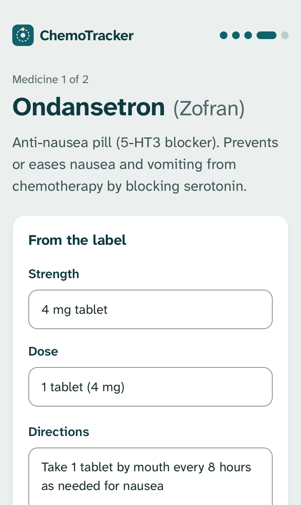
  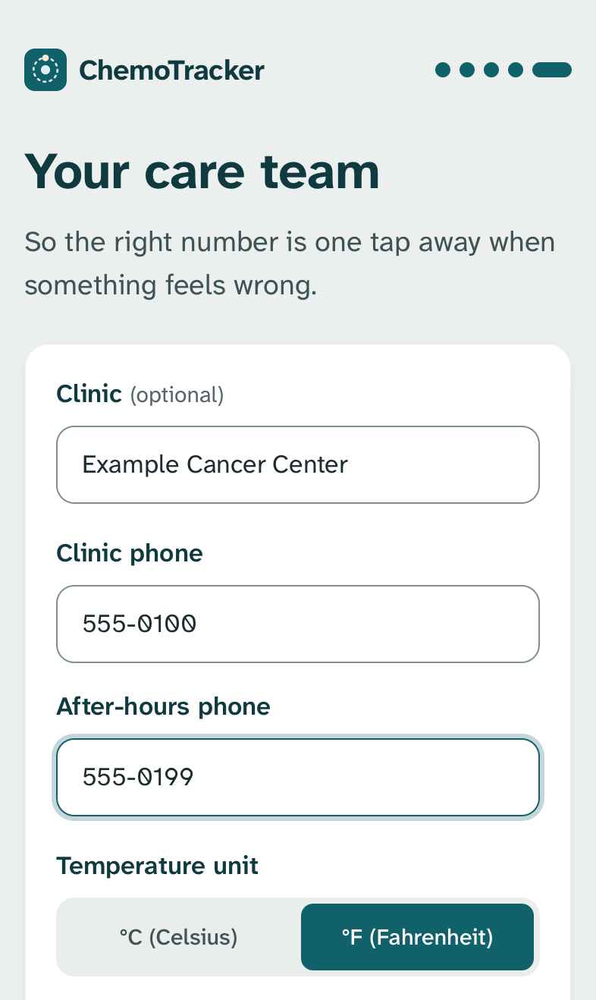
</p>

4. **Which medicines are you taking?** Type or paste what's printed on each bottle, one medicine per line, and tap **Read it**. The app shows what it understood: the strength, the dose, how often, and the days with real dates. Anything it guessed is marked **guess**. You can also tick medicines in the list. Include the ones given at the clinic. Names, addresses and Rx numbers in what you paste are ignored. See [prescription formats](prescription-formats.md) for what it reads.
5. **Check each label.** One page per medicine. Check the strength, the dose and the directions against the bottle. For an as-needed medicine, fill in **Hours between doses** ("every 6 hours" means 6). Without it, the app can't say when the next one is OK. Then pick how it's taken, the days of the cycle and the time. Shots kept in the fridge get a "Get it ready ahead" step, for example taking it out 30 minutes before.
6. **Your care team.** The clinic's phone and after-hours numbers, the temperature unit, and the fever line your team gave you. The phone button at the top of every page calls them. A fever, or anything marked severe, puts the number front and center.

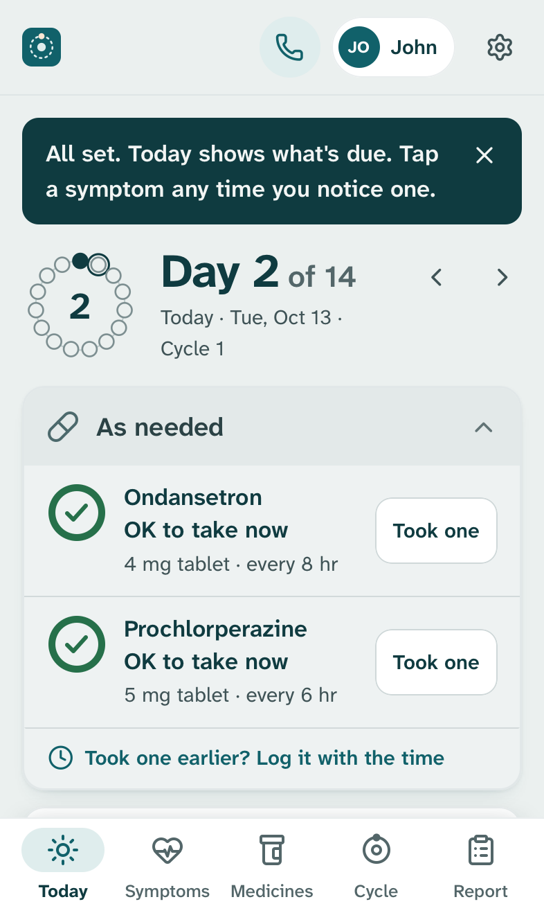

Then you're on **Today**, which shows what's due. To go through the steps again, use **Settings → Run setup again**. It doesn't delete anything.

## Reminders on your phone

Reminders use [ntfy](https://ntfy.sh), a free notification app that doesn't need an account. Open **Settings** (the gear at the top) and find **Reminders on your phone**.

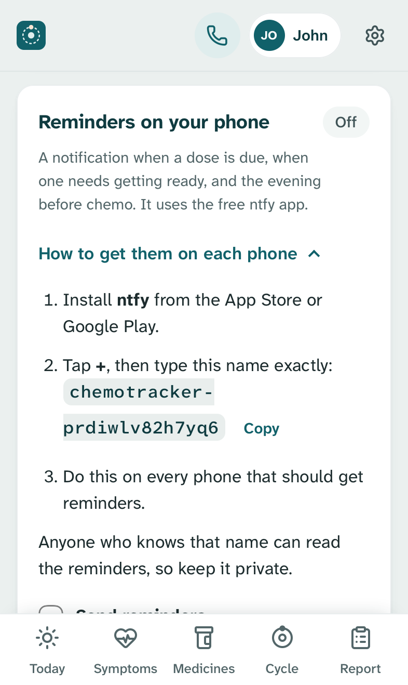

1. On each phone that should get reminders, install **ntfy** from the App Store or Google Play.
2. In ntfy, tap **+** and type the name shown in Settings exactly. **Copy** helps.
3. Back in Settings, tick **Send reminders** and tap **Save reminders**.
4. Tap **Send a test** and check that every phone got it.

You choose when a dose reminder comes (at the dose time or a few minutes before), whether to remind when a dose isn't marked, and whether to remind the evening before chemo. For as-needed medicines you can ask to be told when one is OK again, with overnight ones held for a morning list.

Under **Advanced, for whoever set this up**, set **Link address** to the address the phones use, so tapping a reminder opens the app.

Anyone who knows the reminder name can read the reminders, so keep it private. To leave medicine names out of notifications, untick **Show medicine names**.

## Backups

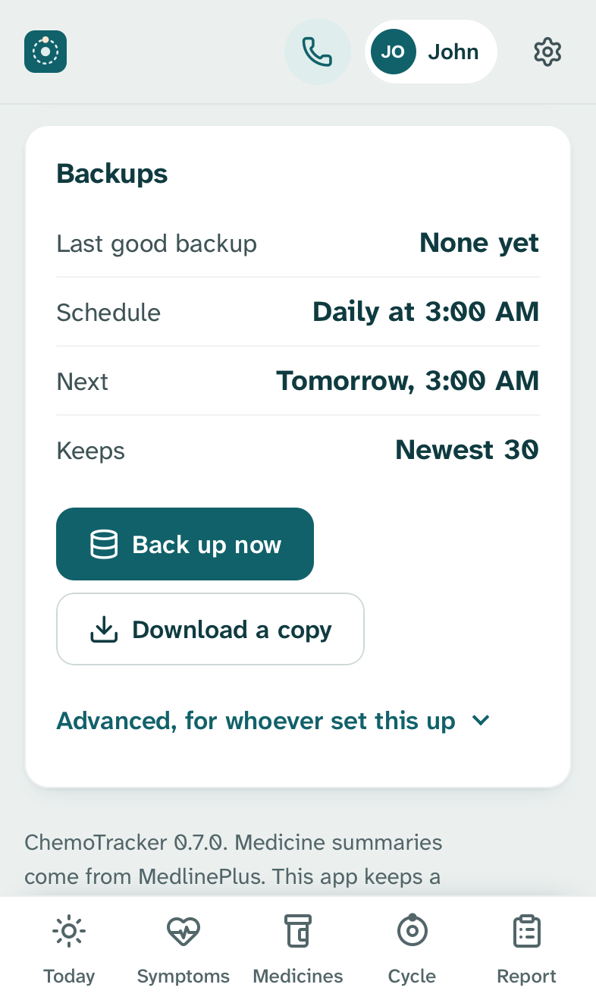

ChemoTracker backs itself up every day at 3:00 AM by default. Each backup is the database plus the Excel report, so it can be read without the app. If the computer was off at 3:00 AM, a backup runs a minute after the app starts.

**Settings → Backups** shows the last good backup and the next one. **Back up now** makes one straight away. **Download a copy** saves one to the phone or computer you're using. **Go back to an earlier copy** shows what's in a backup and restores it. The app saves the current record first, so a restore can be undone.

Keep backups on a different disk from the app if you can. The [README](../README.md#backups-and-restore) covers restoring by hand.

## On a NAS

ChemoTracker runs well on a NAS that runs Docker itself (Synology, QNAP, Unraid, TrueNAS and similar). Put the ChemoTracker folder on the NAS, then point the data and backup folders wherever you keep app data:

```bash
mkdir -p /volume1/docker/chemotracker/data /volume1/docker/chemotracker/backups
```

```ini
# .env
CHEMO_DATA_HOST_DIR=/volume1/docker/chemotracker/data
CHEMO_BACKUP_HOST_DIR=/volume1/docker/chemotracker/backups
CHEMO_UID=1026
CHEMO_GID=100
```

- **Create both folders before the first start.** Otherwise Docker creates them owned by root, and the app can't write to them.
- **Set `CHEMO_UID` and `CHEMO_GID` to the owner of those folders.** Over SSH, `id -u` and `id -g` show your own. The numbers above are only an example. You can also leave the defaults and give the folders to user 10001 (`sudo chown -R 10001:10001 ...`).
- **Keep the data folder on the NAS's own disks.** Don't run Docker on one computer with its data folder on a network share (SMB or NFS) from another. SQLite can't lock files over a network share, so two saves at once could damage the database ([SQLite: WAL mode doesn't work over a network filesystem](https://www.sqlite.org/wal.html)). If Docker runs on another computer, keep the data folder on that computer's own disk, and copy the backups to the NAS with your usual sync or backup tool.

If your NAS's Docker app takes a compose file (a "project"), use the ChemoTracker folder as the project folder so it finds `compose.yaml` and `.env`.

## Away from home

Don't forward the port on your router, and don't put ChemoTracker on the open internet. To use it away from home, use [Tailscale](https://tailscale.com):

1. In `.env`, set `CHEMO_BIND=127.0.0.1` and `CHEMO_SECURE_COOKIE=1`, then run `docker compose up -d`.
2. Run `tailscale serve --bg 8000` on the computer running ChemoTracker.
3. Install Tailscale on each phone and sign in to the same tailnet. Open the `https://` address that `tailscale serve` printed.

[SECURITY.md](../SECURITY.md) covers reverse proxies and what's protected.

## Updating

```bash
cd ChemoTracker
git pull
docker compose up -d --build
```

The data folder and backups stay as they are. Before a new version changes the database's structure, the app saves a "Saved before an update" copy, which **Settings → Backups → Go back to an earlier copy** lists. The version number is at the bottom of Settings.

## Show the family

Everyone else only needs a few things. Show them once on their own phone.

<p>
  
  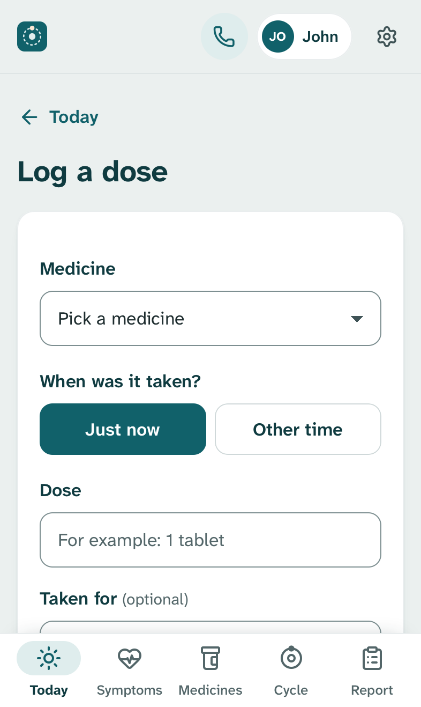
  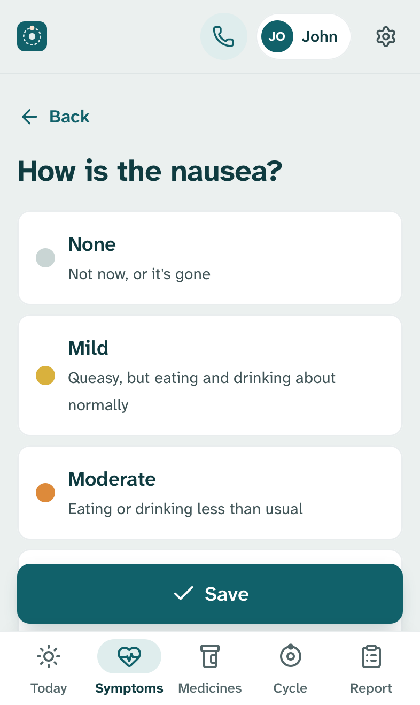
  
</p>

- **Open it from the home-screen icon.** The first time, tap your name. The phone remembers it. To hand the phone to someone else, tap the name at the top and switch.
- **Today** shows the doses for each time of day. Tap **Taken** after a dose and say when: **Just now** or **Other time**. A wrong tap can be undone.
- **As needed** medicines show a ring that counts down to when the next one is OK. **Took one** logs it.
- **Took one earlier?** At the bottom of the As needed list, log it with the time it was taken.
- **Symptoms:** tap what you feel, then how bad it is. After nausea, the app shows which of your nausea medicines are OK to take now. A fever or anything severe shows the care team's number.
- **Report** makes the Excel file for the care team.

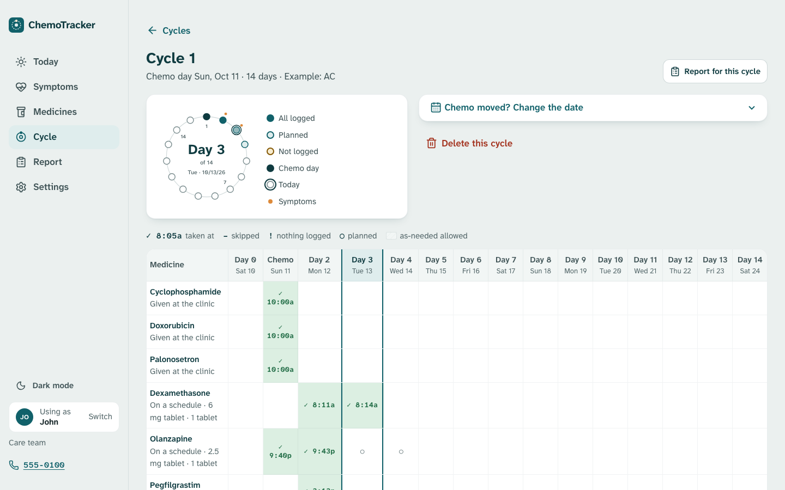
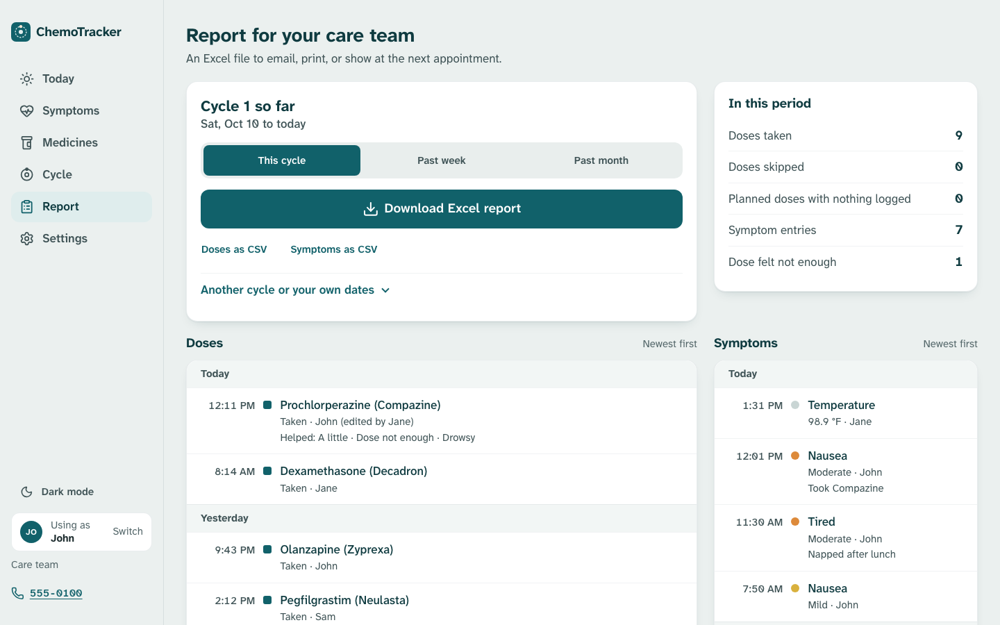

## If something isn't working

- **A phone can't open it.** Check that the phone is on the same Wi-Fi (guest networks often keep devices apart), that the address ends in `:8000`, and that the computer is awake. If the computer asks whether Docker may accept incoming connections, allow it. On Windows, allow it on private networks.
- **Times are off by hours.** Set `TZ` in `.env`, then run `docker compose up -d`.
- **It won't start on Linux or a NAS, with "permission denied".** The data or backup folder belongs to another user. See the `CHEMO_UID` note above.
- **"Another copy of ChemoTracker is already using this data folder."** Two copies were started on the same data folder. Stop the other one (`docker ps` lists them).
- **Reminders don't arrive.** Tap **Send a test**. Check that ntfy on the phone has the exact name from Settings and that notifications are allowed for ntfy. The computer running ChemoTracker has to be on.
- **Something else.** `docker compose logs --tail 50` shows the app's recent messages. Open an issue, but leave out names, numbers and anything else personal.
